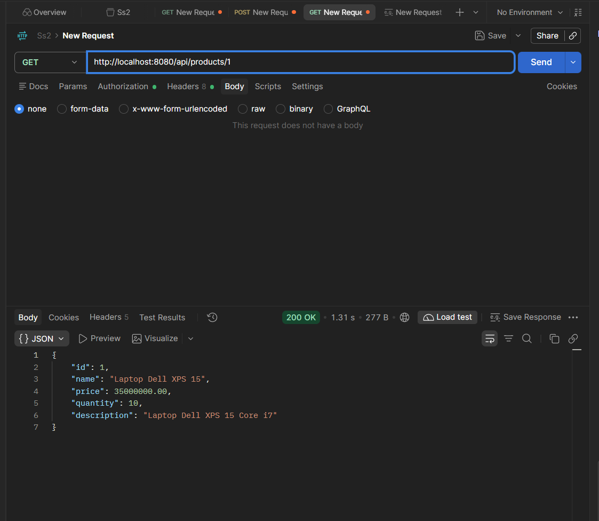
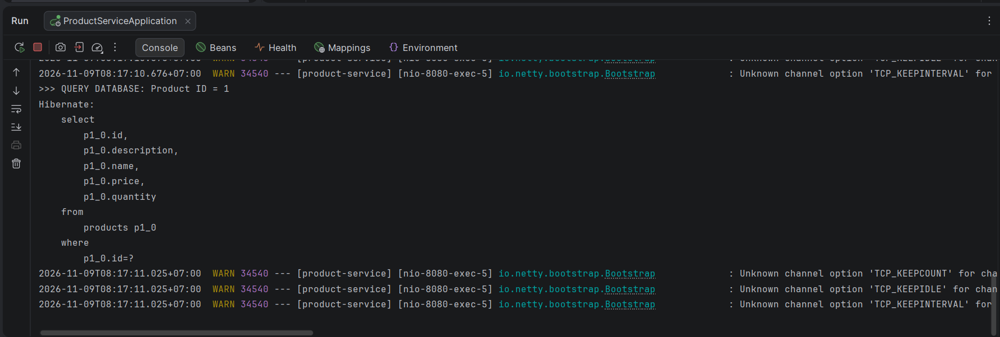
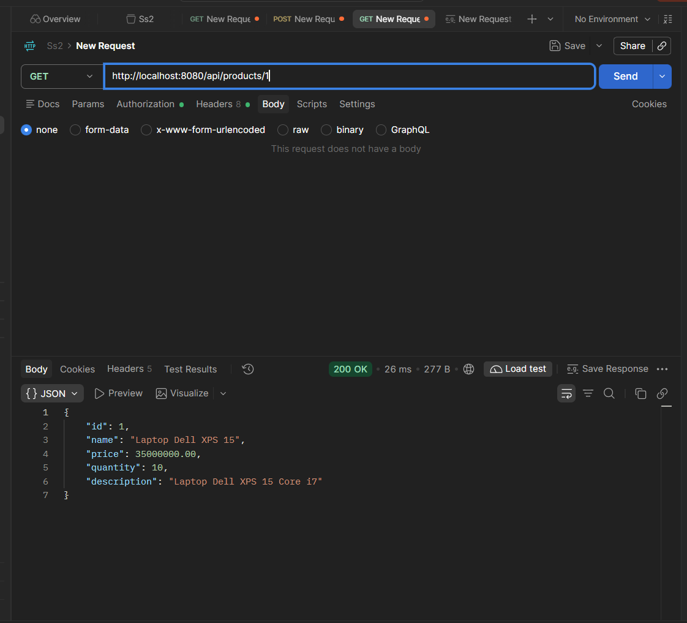
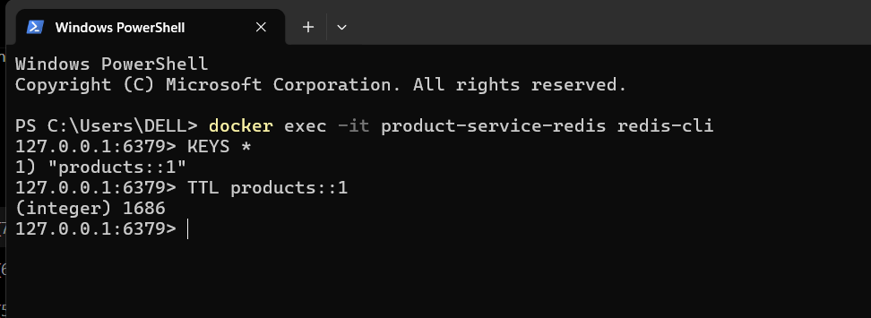
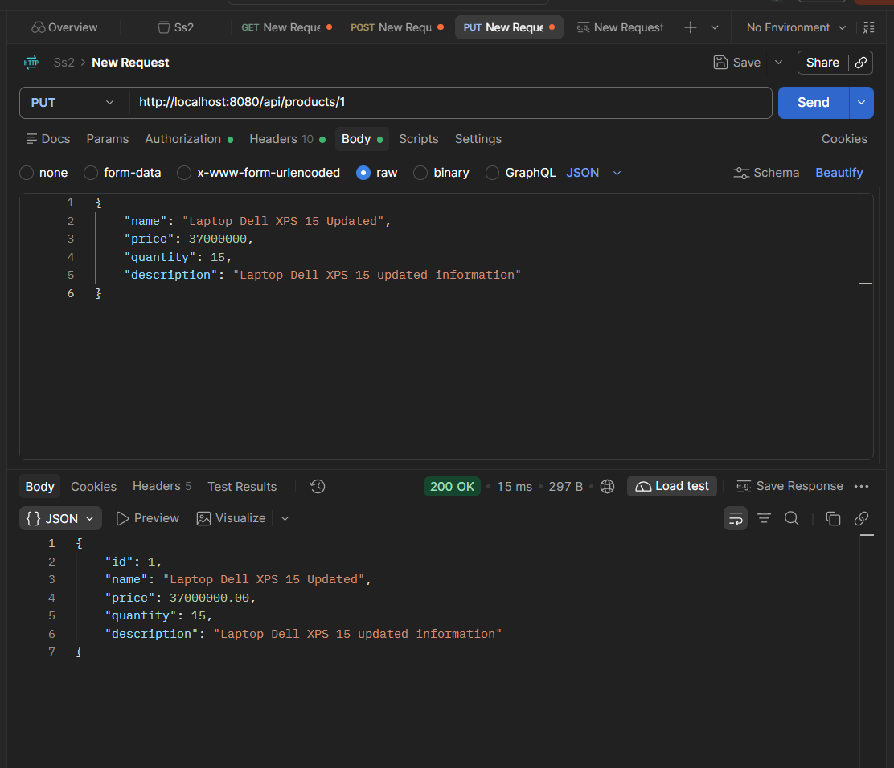
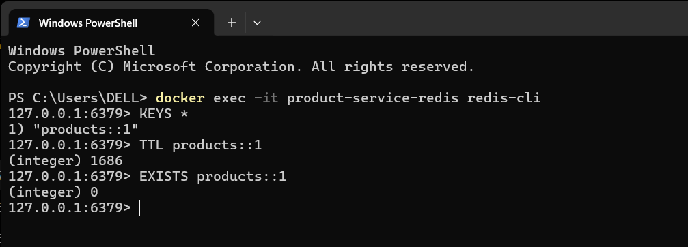
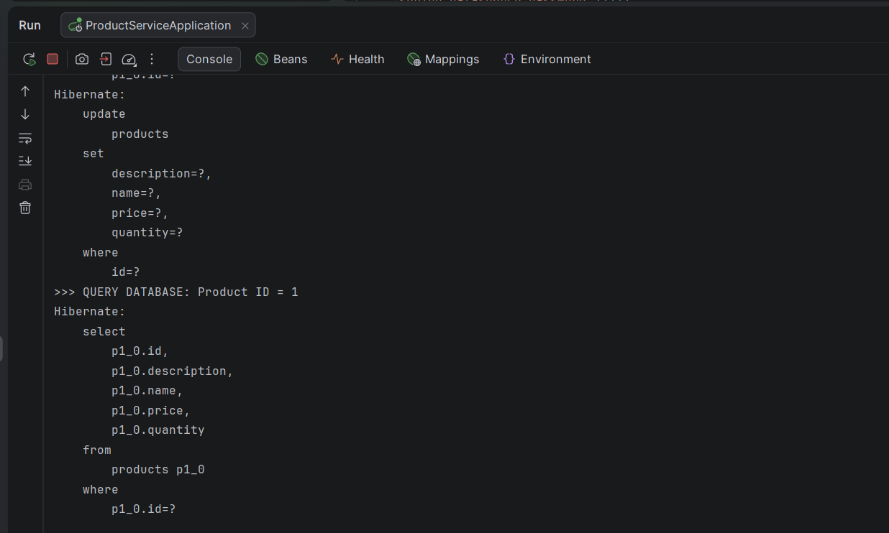

# REDIS CACHE – PROOF OF SUCCESS

## 1. Kiểm chứng Cache Miss

**Thực hiện:** Gửi request lần đầu:

```http
GET /api/products/1
```



**Kết quả:**
- PostgreSQL thực hiện truy vấn SELECT.
- Console xuất hiện log `QUERY DATABASE`.
- Thông tin sản phẩm được lưu vào Redis.



## 2. Kiểm chứng Cache Hit

**Thực hiện:** Gửi lại request:

```http
GET /api/products/1
```


**Kết quả:**
- API vẫn trả về thông tin sản phẩm chính xác.
- Không xuất hiện thêm log `QUERY DATABASE`.
- Không phát sinh truy vấn SELECT mới cho request GET.
- Redis trả dữ liệu từ cache.

**Kết luận:** Nhiều request đọc cùng một sản phẩm không cần truy vấn PostgreSQL lặp lại.

## 3. Kiểm chứng TTL 30 phút

**Thực hiện:** Kiểm tra thời gian tồn tại của cache trong Redis:

```redis
TTL products::1
```

**Kết quả:**



Giá trị TTL ban đầu khoảng 1686 giây (xấp sỉ 28 phút) và giảm dần theo thời gian.

**Kết luận:** Cache có thời hạn 30 phút, sau đó Redis tự động hết hạn key nếu chưa bị xóa trước.

## 4. Kiểm chứng tự động xóa cache khi cập nhật

**Thực hiện:** Gửi request cập nhật sản phẩm:

```http
PUT /api/products/1
```

Sau khi cập nhật thành công, kiểm tra:

```redis
EXISTS products::1
```

**Kết quả:**



**Kết luận:** Cache của sản phẩm được tự động xóa sau khi quản trị viên cập nhật thông tin thành công.

## 5. Kiểm chứng dữ liệu sau cập nhật

**Thực hiện:** Gửi lại request:

```http
GET /api/products/1
```

**Kết quả:**


- PostgreSQL được truy vấn lại.
- Console xuất hiện log `QUERY DATABASE`.
- API trả về thông tin sản phẩm mới nhất.
- Redis tạo lại cache với dữ liệu đã cập nhật.